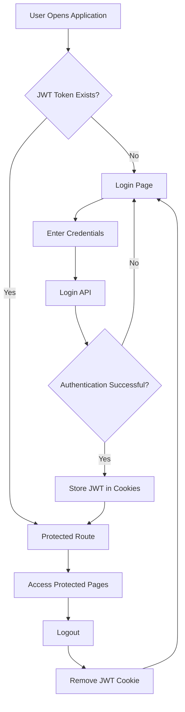

# 🛍️ Nxt Trendz – E-Commerce Shopping Application

A React-based e-commerce shopping application that provides a seamless online shopping experience with secure authentication, product browsing, filtering, product details, and comprehensive shopping cart management.

## 🌐 Live Demo

**[Visit Nxt Trendz – Live Application](https://manir041.ccbp.tech)**

## 📌 Project Overview

Nxt Trendz is a modern e-commerce shopping application developed using React.js. It enables users to authenticate securely, explore products, search and filter items, view product details, discover similar products, and manage their shopping cart.

The application uses React Router for navigation, Context API for centralized cart state management, JS Cookies for authentication, and external REST APIs for backend data integration.

The project focuses on delivering a responsive and user-friendly shopping experience with features such as product sorting, category filtering, rating filters, quantity management, and cart summaries.

## ✨ Features

### 🔐 User Authentication

- User login and logout functionality.
- JWT-based authentication.
- Authentication token storage using JS Cookies.
- Protected routes for authenticated users.
- Automatic redirection to the login page when authentication is missing.
- JWT token included in protected API request headers.

### 🛍️ Product Browsing

- Display a collection of products.
- Search products by name.
- Filter products by category.
- Filter products based on customer ratings.
- Sort products using available sorting criteria.
- View detailed information about individual products.
- Explore similar products.
- Browse Prime Deals.

### 🛒 Shopping Cart Management

- Add products to the shopping cart.
- Manage cart state globally using React Context API.
- Increase or decrease product quantities.
- Remove individual products from the cart.
- Remove all products from the cart.
- Automatically update item quantities and total prices.
- Display a cart summary.

### 🎨 User Interface

- Responsive user interface.
- Client-side navigation using React Router.
- Loading indicators using React Loader Spinner.
- Interactive icons using React Icons.
- CSS-based styling.

## 🛠️ Technology Stack

| Technology             | Purpose                       |
| ---------------------- | ----------------------------- |
| React.js 17            | Building the user interface   |
| React Router DOM 5.2.0 | Client-side routing           |
| React Context API      | Global cart state management  |
| JS Cookies             | Authentication token storage  |
| Fetch API              | Backend REST API integration  |
| React Icons            | UI icons                      |
| React Loader Spinner   | Loading indicators            |
| CSS                    | Styling and responsive design |
| Create React App       | Development environment       |
| Jest                   | Testing                       |
| ESLint                 | Code quality                  |

## 🔌 API Endpoints Overview

The application integrates with external REST APIs to handle authentication and retrieve product information.

| API                 | Component                                    | Functionality                                                                 |
| ------------------- | -------------------------------------------- | ----------------------------------------------------------------------------- |
| Login API           | `src/components/LoginForm/index.js`          | Authenticates users and returns a JWT token                                   |
| Products API        | `src/components/AllProductsSection/index.js` | Retrieves products and supports search, category, rating, and sorting filters |
| Product Details API | `src/components/ProductItemDetails/index.js` | Retrieves individual product details and similar products                     |
| Prime Deals API     | `src/components/PrimeDealsSection/index.js`  | Retrieves Prime Deals products                                                |

### API Integration

- Backend communication is performed using the Fetch API.
- The Login API authenticates users and returns a JWT token.
- The authentication token is stored in cookies.
- Protected API requests include the JWT token in their request headers.
- Product listing APIs support filtering and sorting.
- Product Details APIs retrieve individual product information and similar products.

## 🔐 Authentication Flow

The application implements JWT-based authentication with protected routes.



### Authentication Process

1. The user enters credentials through the Login page.
2. The Login API validates the credentials.
3. On successful authentication, the API returns a JWT token.
4. The token is stored in cookies using JS Cookies.
5. The Protected Route component checks for the authentication token.
6. If the token is available, the user can access protected pages.
7. If the token is missing, the user is redirected to the Login page.
8. During logout, the token is removed and the user is redirected to Login.

## 🔑 Demo Credentials

The application provides demo accounts for both Prime and Non-Prime users.

### Prime User

| Field    | Value        |
| -------- | ------------ |
| Username | `rahul`      |
| Password | `rahul@2021` |

### Non-Prime User

| Field    | Value       |
| -------- | ----------- |
| Username | `raja`      |
| Password | `raja@2021` |

**Note:** These credentials are provided for demonstration and testing purposes only.

## 🛒 Cart State Management

The application uses React Context API to maintain cart state across multiple components.

The cart context is implemented in:

`src/context/CartContext.js`

### Cart Operations

- Add items to the cart.
- Update product quantities.
- Remove individual cart items.
- Clear the entire cart.
- Calculate total item quantities.
- Calculate the total cart price.

This centralized state management approach allows different components to access and update cart information without extensive prop drilling.

## 📂 Project Structure

```text
nxt-trendz-cart-features/
│
├── public/
│
├── src/
│   ├── components/
│   │   ├── LoginForm/
│   │   ├── ProtectedRoute/
│   │   ├── AllProductsSection/
│   │   ├── ProductItemDetails/
│   │   ├── PrimeDealsSection/
│   │   └── ...
│   │
│   ├── context/
│   │   └── CartContext.js
│   │
│   ├── App.js
│   ├── index.js
│   └── ...
│
├── package.json
├── package-lock.json
├── LICENSE
└── README.md
```

*Note: This structure highlights the major components and files. Additional components and files may exist in the project.*

## 🚀 Installation and Setup

### Prerequisites

Ensure that the following software is installed:

- Node.js
- npm
- Git

### Step 1: Clone the Repository

```bash
git clone <your-repository-url>
```

### Step 2: Navigate to the Project Directory

```bash
cd nxt-trendz-cart-features
```

### Step 3: Install Dependencies

```bash
npm install
```

This command installs the dependencies specified in `package.json`.

### Step 4: Start the Development Server

```bash
npm start
```

The application will start using Create React App.

Open your browser and navigate to:

**[http://localhost:3000](http://localhost:3000)**

## 📜 Available Scripts

The following scripts are available in `package.json`:

| Command            | Description                                  |
| ------------------ | -------------------------------------------- |
| `npm start`        | Starts the development server                |
| `npm run build`    | Creates a production build                   |
| `npm test`         | Runs the test suite                          |
| `npm run lint`     | Runs ESLint                                  |
| `npm run lint:fix` | Fixes linting issues in the source directory |
| `npm run format`   | Formats source files using Prettier          |
| `npm run run-all`  | Runs tests and linting tasks in parallel     |

## 🔮 Future Enhancements

The following features can be added to improve the application:

- **Wishlist Functionality:** Allow users to save their favorite products.
- **User Profile Management:** Enable users to manage their personal information.
- **Payment Gateway Integration:** Support secure online payments.
- **Order History:** Allow users to view previous orders.
- **Product Reviews and Ratings:** Enable customers to review products.
- **Dark Mode:** Introduce a dark theme for improved accessibility.
- **Product Recommendations:** Suggest products based on user preferences.
- **Advanced Filtering:** Add additional product filtering options.
- **Pagination:** Improve product browsing for large product collections.
- **Persistent Cart Storage:** Integrate backend database storage to preserve cart information across sessions and devices.

## 👨‍💻 Author

**Manisharma Jupudi**

GitHub: [Manisharma Jupudi](https://github.com/manisharma-jupudi/nxt-trendz-ecommerce)

## 📄 License

This project is licensed under the [MIT License](LICENSE).

You are free to use, modify, and distribute this software in accordance with the terms of the MIT License.
